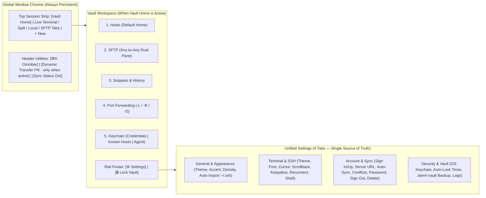

# STerm SSH — Comprehensive Flow, Information Architecture & Feature Audit

> [!TIP]
> **Migration Status (2026-11-22) — Full Pure-Rust GPUI Cutover Completed**:
> The legacy Tauri + React frontend (`src/`, `src-tauri/`, Node/npm) has been retired in favor of the standalone native GPUI client (`crates/sterm-gpui`). All **Phase 1 safety & data-loss fixes** (local-first onboarding, full host metadata preservation, lossless offline→cloud upgrade, FIFO HostKey/KBI challenge queues, multi-prompt KBI, MITM expected fingerprint, SFTP↔Terminal session ref-counting, destructive confirmation modals, auth-only retry banner, removed SFTP 6-host cap) and **Phase 2 unified Information Architecture** (persistent Top Session Tab Strip, 4-item Vault rail + bottom Settings/Lock, nested Split Panes, `Ctrl+K` Command Palette, `Ctrl+F` Search, `Ctrl+Space` Suggestions, Snippets library, selective `~/.ssh/config` import, `chmod` matrix, remote rename, native OS file dialogs, unified 4-tab Settings with Delete Account) are now implemented and verified in `crates/sterm-gpui`. **Phase 3** features (SSH Port Forwarding, Local Shell, Recursive SFTP, Agent Forwarding, Auto-Lock) remain on the post-migration roadmap below.

> [!IMPORTANT]
> **Original Scope of Audit**: Full end-to-end review of **all flows, pages, modals, and features** across both desktop clients in this repository — **Tauri + React** (`src/` + `src-tauri/`) and **Native GPUI Admin Studio** (`crates/sterm-gpui/`) — plus all shared core crates (`core-ssh`, `core-sftp`, `core-vault`, `core-crypto`, `core-sync`), benchmarked against **Termius**, **Tabby**, **Electerm / WindTerm**, **Royal TSX / MobaXterm**, and **Warp**.

---

## 1. Executive Summary & Architectural Root Cause

STerm SSH already has a **genuinely strong Rust core**: `russh` pure-Rust SSH with multi-hop `ProxyJump`, TOFU host-key verification, `russh-sftp` streaming transfers, and an exemplary zero-knowledge E2EE sync architecture (Argon2id → HKDF-SHA256 → wrapped DEK → per-record AES-256-GCM).

However, from a **product flow and Information Architecture (IA)** standpoint, the project currently suffers from **five structural issues**:

1. **Split-Personality Dual Frontends**: Tauri+React (`3` nav sections + top session tabs) and Native GPUI (`7` sidebar pages + Dynamic Island) have diverged sharply in layout, flows, and feature parity — while sharing the same SQLite database (`app.sterm.ssh/sterm-vault.db`). Editing a host in GPUI even **silently erases fields** created in Tauri (`tags`, `terminal_theme`, `startup_command`, `notes`).
2. **Broken "Local-First" Onboarding**: Despite positioning as local-first with *optional* sync, Tauri's first-run screen forces users to authenticate against `http://127.0.0.1:8787` with no way to initialize an offline vault.
3. **Misplaced & Fragmented Pages**: Settings, Sync, Account, Import, and Backups are either jammed into one overloaded page (Tauri's `Sync & Settings`) or scattered across **four different screens** (GPUI's `E2EE Sync`, `Settings → Appearance`, `Settings → Account`, `Settings → Security`). Meanwhile, core SSH pillars (**Snippets**, **Known Hosts**, **SFTP**, **Port Forwarding**) are either trapped inside popovers, missing from one frontend, or absent altogether.
4. **Unwired Backend Capabilities**: Several features already exist in Rust (`sftp_remote_rename`, `GroupRecord` nesting + default credential inheritance, `KnownHostRecord` in Tauri store, `HostOverride` on split panes, `rekey_session`, `sync` conflict reports) but are never connected to the UI.
5. **Critical Feature Gaps vs. Termius & Peers**: Missing **SSH Port Forwarding / Tunnels (`-L`/`-R`/`-D`)**, **Local Shell**, **Broadcast Input**, **Recursive SFTP Folders**, **Agent Forwarding**, **`ssh-copy-id` Key Deployment**, **Auto-Reconnect**, and **Auto-Lock Timer**.

---

## 2. Critical Flow Bugs & Data-Safety Hazards Found in Code

Before rearranging pages, these concrete flow defects directly harm usability or cause data/session loss:

| Severity | Area | Exact Finding & Evidence | Impact |
|---|---|---|---|
| **P0 · Blocker** | **First-Run Onboarding (Tauri)** | In [UnlockScreen.tsx](../src/components/vault/UnlockScreen.tsx#L237-L252), the offline toggle is gated by `{status.initialized && (...)}`. `useVaultStore.initialize()` in [useVaultStore.ts](../src/stores/useVaultStore.ts#L79-L84) is never called anywhere. | Brand-new Tauri users **cannot use the app offline** — they hit `"Cannot reach sync server (http://127.0.0.1:8787)"` and are dead-ended. |
| **P0 · Data Loss** | **Cross-Client Host Edit (GPUI)** | In [app.rs](../crates/sterm-gpui/src/app.rs#L992-L1009), `save_host_from_modal` hardcodes `tags: Vec::new()`, `terminal_theme: None`, `startup_command: None`, `notes: None` on edits. | Editing any host in GPUI **permanently wipes** its tags, terminal theme, startup command, and notes from the shared vault & syncs the wipe to other devices. |
| **P0 · Data Loss** | **Offline → Account Upgrade Wipe** | In [sync_cmd.rs](../src-tauri/src/commands/sync_cmd.rs#L83-L89) & [backend.rs](../crates/sterm-gpui/src/backend.rs#L365-L370), registering while locked calls `reset_local_vault()`; signing into an account also resets local items without warning ([sync_cmd.rs](../src-tauri/src/commands/sync_cmd.rs#L207-L209)). | A user who adds hosts offline, locks the vault, and later creates a sync account **silently loses all local hosts & keys**. |
| **P1 · Session Leak / Break** | **SFTP ↔ Terminal Session Coupling** | Closing an SFTP tab in [useWorkspaceStore.ts](../src/stores/useWorkspaceStore.ts#L379-L384) returns `[]`, leaking transport-only SSH connections forever. Conversely, closing a Terminal tab calls `sftp.close(&session_id)` ([ssh_cmd.rs](../src-tauri/src/commands/ssh_cmd.rs#L326), [app.rs](../crates/sterm-gpui/src/app.rs#L1374)), silently killing an open SFTP tab sharing that session. | Zombie connections on standalone SFTP; mid-transfer crashes when closing a terminal tab. |
| **P1 · Auth Hang** | **Global Single Challenge Slot** | Both [useWorkspaceStore.ts](../src/stores/useWorkspaceStore.ts#L77-L78) and [app.rs](../crates/sterm-gpui/src/app.rs#L120) store a single `hostKeyChallenge` / `kbiChallenge` instead of a FIFO queue. | Connecting to 2 new hosts simultaneously drops the first challenge modal, hanging its `oneshot` channel indefinitely. |
| **P1 · Auth Broken** | **Multi-Prompt 2FA/KBI & MITM Info (GPUI)** | [views.rs](../crates/sterm-gpui/src/views.rs#L3634-L3703) only renders `ch.prompts.first()` and submits `vec![ans]`. Also [views.rs](../crates/sterm-gpui/src/views.rs#L3570-L3582) omits `expected_fingerprint` on MITM mismatch. | PAM/2FA servers sending 2 prompts in one round fail in GPUI; MITM warnings hide the previously trusted fingerprint. |
| **P1 · Destructive UX** | **Zero-Confirmation Deletions** | Deleting a Host ([HostGrid.tsx](../src/components/vault/HostGrid.tsx#L408), [views.rs](../crates/sterm-gpui/src/views.rs#L1100)), Keychain secret ([KeychainView.tsx](../src/components/vault/KeychainView.tsx#L437)), Remote SFTP file in GPUI ([views.rs](../crates/sterm-gpui/src/views.rs#L2514)), or Sidebar Log Out in GPUI ([app.rs](../crates/sterm-gpui/src/app.rs#L2944)) executes **immediately with 1 click**. | One accidental click deletes a production server record, private key, or remote file with no undo. |
| **P1 · Reachability** | **GPUI SFTP 6-Host Cap** | [views.rs](../crates/sterm-gpui/src/views.rs#L1684) slices `self.snapshot.hosts.iter().take(6)`. | Servers #7+ cannot be picked from the SFTP page's Remote Target selector. |
| **P2 · Misleading UX** | **False Password Retry Banner (Tauri)** | [TerminalPane.tsx](../src/components/terminal/TerminalPane.tsx#L697-L724) displays `"Auth retry password:"` for **every** `status === "error"` (including DNS failures, timeouts, and rejected host keys). | Confuses users on network errors; also fails to distinguish passphrase-locked private keys. |
| **P2 · UX Friction** | **Theme Reset & Orphaned Credentials** | `uiTheme` in [useWorkspaceStore.ts](../src/stores/useWorkspaceStore.ts#L145) isn't persisted (resets to Dark on launch). Re-entering inline keys/passwords in [HostModal.tsx](../src/components/vault/HostModal.tsx#L177-L213) or [app.rs](../crates/sterm-gpui/src/app.rs#L973-L990) mints new orphan `CredentialRecord`s instead of updating. | Preferences lost on restart; Keychain fills up with stale duplicate credentials. |

---

## 3. Page-by-Page & Feature Placement Audit ("Is It in the Right Place?")

### A. Tauri + React Client (`src/`) — Placement Verdict

| Current Location | What Lives There Today | Verdict | Concrete Placement & Flow Issues |
|---|---|---|---|
| **Unlock / Auth Screen** ([UnlockScreen.tsx](../src/components/vault/UnlockScreen.tsx)) | Sign In, Create Account, Server URL footer, conditional Offline fallback | ⚠️ **Misaligned Flow** | Defaults to a cloud server (`127.0.0.1:8787`) and hides offline mode for new users. Should offer **"Local Vault (Offline)"** vs **"Sign In to Sync"** upfront. |
| **Top Tab Bar** ([AppShell.tsx](../src/components/layout/AppShell.tsx#L228-L274)) | Pinned `Vault` tab + open Terminal & SFTP tabs | ✅ **Right Pattern** *(needs polish)* | Good Termius-like model! Issue: clicking `Vault` shows whichever sidebar section was last open (even Settings), and there is no `+` button on the tab strip to open a host/local shell or reorder tabs. |
| **Left Rail → `Hosts`** ([HostGrid.tsx](../src/components/vault/HostGrid.tsx)) | Host cards, flat group pills, search, `~/.ssh` discovery banner, Import modal, New Host modal | ✅ **Correct Home** *(incomplete)* | Right default page! Missing: Table/List toggle (cards don't scale past ~30 servers), Group edit/delete/nesting, clickable Tag filters, Favorites/Recent section, Host context menu/duplicate, Auth & ProxyJump badges on cards. |
| **Left Rail → `Keychain`** ([KeychainView.tsx](../src/components/vault/KeychainView.tsx)) | Credentials list, inline Generate Ed25519 & Add Credential forms | ⚠️ **Incomplete & Polluted** | Right top-level section, **but**: (1) **Missing Known Hosts (TOFU)** even though [useVaultStore.ts](../src/stores/useVaultStore.ts#L20) already loads `knownHosts`; (2) Polluted with non-secret auth modes (`Local SSH Agent`, `Keyboard-Interactive`) created automatically by `HostModal`; (3) No **Edit** credential, no **"Used by N hosts"** check, no search/filter. |
| **Left Rail → `Sync & Settings`** ([AccountView.tsx](../src/components/account/AccountView.tsx)) | Account card, `~/.ssh` auto-import checkbox, Terminal Style + Preview, Change Password, collapsible Backup & Delete Account | ❌ **Misplaced & Overloaded** | **Wrong IA bucket.** Nav label says `Sync & Settings` (Cloud icon), heading says `Account & Preferences`, and it mixes Terminal Typography, `~/.ssh` Auto-Import, Cloud Sync, Password Change, and Offline Backup into one narrow left-aligned scroll column. Also: if unlocked offline, there is **no way to sign in to Sync** here without signing out! |
| **Left Rail Bottom** ([AppShell.tsx](../src/components/layout/AppShell.tsx#L196-L222)) | Dark/Light Mode toggle + Lock Vault | ⚠️ **Partially Misplaced** | `Lock Vault` belongs here. `Settings` (Gear icon) should anchor at the bottom rail too, while Dark/Light Mode should ALSO live in `Settings → Appearance` (and persist!). |
| **Command Palette (`⌘K`)** ([CommandPalette.tsx](../src/components/layout/CommandPalette.tsx)) | Host search + `user@host:port` quick connect | ⚠️ **Under-Scoped** | Right shortcut & overlay position, **but** only searches hosts (doesn't search Snippets, SFTP, Keychain, Open Tabs, or App Actions). Quick Connect cannot pick a saved Keychain key or Jump Host, and cannot save the connection to Vault. |
| **Terminal Popover → `Suggested Commands`** ([TerminalPane.tsx](../src/components/terminal/TerminalPane.tsx#L782-L945)) | Pinned snippets, history, 10 starter tips, inline Save form | ❌ **Trapped Feature** | Inline `Ctrl+Space` autocomplete is great, **but**: (1) Snippets have **no Vault management page** — impossible to organize/edit/browse without an active SSH connection; (2) Popover is anchored `bottom-2.5` and covers the prompt line when the cursor is near the bottom of the terminal! |
| **SFTP (`SftpDualPane.tsx`)** ([SftpDualPane.tsx](../src/components/sftp/SftpDualPane.tsx)) | Opened only as a tab from Host card or Terminal toolbar | ⚠️ **Missing Entry Point & Parity** | Works as a session tab, **but** needs: (1) Top-level `SFTP` entry point (or docked SFTP drawer inside Terminal); (2) Double-click behavior is asymmetric & risky (Local double-click = immediate upload; Remote double-click = open text editor even on binary files); (3) Uses jarring browser-native `window.prompt()` / `window.confirm()`. |
| **Global `TransferDrawer`** ([TransferDrawer.tsx](../src/components/sftp/TransferDrawer.tsx)) | Bottom bar across entire workspace when transfers exist | ✅ **Good Placement** | Clean non-blocking UX; only appears when transfers exist. Should add transfer speed (MB/s), ETA, and Retry on failure. |

---

### B. Native GPUI Admin Studio (`crates/sterm-gpui/`) — Placement Verdict

| Current Location | What Lives There Today | Verdict | Concrete Placement & Flow Issues |
|---|---|---|---|
| **Sidebar → `Overview`** ([views.rs](../crates/sterm-gpui/src/views.rs#L399-L750)) | 4 KPI cards, 4 action buttons, first 8 hosts ("Recent Servers") | ❌ **Unnecessary Landing Page** | Feels like a web SaaS admin panel, not an SSH workstation. "Recent Servers" isn't even sorted by recency (just `.take(8)`). Every action here duplicates `Servers`, `SFTP`, and `Settings`, adding an extra hop before connecting. **Merge into `Hosts` (with a compact Recent/Pinned bar).** |
| **Sidebar → `Servers`** ([views.rs](../crates/sterm-gpui/src/views.rs#L755-L1116)) | Data table of hosts, group filter pills, search, Import, Add Server | ✅ **Right Core View** *(missing modal fields)* | Great dense table layout + compact density! Should be the **default landing page** (renamed `Hosts` for consistency with Tauri). `HostEditor` modal is missing ProxyJump UI (`selected_jump_host_id` exists in Rust but has no control!), Tags, Notes, Startup Command, and Keepalive. |
| **Sidebar → `Terminals`** ([views.rs](../crates/sterm-gpui/src/views.rs#L1121-L1649)) | Terminal tab bar, single or 2-pane horizontal split | ❌ **Wrong Hierarchy** | Burying active terminal sessions inside a sidebar page breaks SSH multitasking: switching to `Servers` or `SFTP` hides all your active tabs! Active sessions belong in a **persistent top window tab bar** (just like Tauri & Termius). |
| **Sidebar → `SFTP Files`** ([views.rs](../crates/sterm-gpui/src/views.rs#L1654-L2571)) | Dual-pane Local ↔ Remote with native Drag & Drop & OS drop | ✅ **Good Standalone Entry** *(needs multi-host & parity)* | Having SFTP in the sidebar is **better than Tauri**, and native drag-drop + `uniform_list` virtualization are standout strengths! Needs: searchable host dropdown (remove 6-host cap!), multi-session SFTP tabs, Chmod, Rename, Hidden files toggle, and delete confirmation. |
| **Sidebar → `Keychain`** ([views.rs](../crates/sterm-gpui/src/views.rs#L2576-L2827)) | 2-column split: Saved Credentials + Trusted Known Hosts (TOFU) | ✅ **Best Placement in Repo** | Pairing **Credentials** and **Known Hosts** here is the cleanest IA in the codebase! Missing: Copy Public Key button on saved keys, Edit credential, Certificate & 2FA/KBI kinds, search/filter. |
| **Sidebar → `E2EE Sync`** ([views.rs](../crates/sterm-gpui/src/views.rs#L2832-L3025)) | Sync status, Sign In / Create Account, Sync Now, Sign Out | ❌ **Redundant Page** | Directly duplicates `Settings → Account & Sync` AND the sidebar bottom `Vault Sync` pill. **Fold completely into `Settings → Account & Sync`** (keep only a compact sync-status indicator pill in the header/sidebar footer). |
| **Sidebar → `Settings`** ([settings_view.rs](../crates/sterm-gpui/src/settings_view.rs)) | 4 tabs: `Appearance & GUI`, `Terminal & SSH`, `Account & Sync`, `Vault & Backup` | ✅ **Great Structure** *(fix misplaced toggles)* | Far cleaner than Tauri's `AccountView`! **Misplaced controls inside it**: (1) `Automatic E2EE Sync` toggle is in **`Appearance & GUI`** ([settings_view.rs](../crates/sterm-gpui/src/settings_view.rs#L345-L354)) — move to `Account & Sync`; (2) `Account & Sync` lacks the Sign In form when signed out; (3) `Vault & Backup` requires manually typing a file path instead of a native file picker; (4) Missing Delete Account flow. |
| **Top Header Bar** ([app.rs](../crates/sterm-gpui/src/app.rs#L2985-L3127)) | Page Title + **Dynamic Transfer Island** + `⚙` Settings + Theme Toggle + `+ Connect` | ⚠️ **Cluttered & Duplicated** | `⚙` Settings duplicates the sidebar `Settings` item; Theme Toggle duplicates `Settings → Appearance`; **Dynamic Transfer Island** permanently hogs center prime real estate even when idle (`"SFTP Ready · Drag & Drop"`) and uses hardcoded `right(180px)` popover math ([views.rs](../crates/sterm-gpui/src/views.rs#L3039)). Replace idle center slot with a **`⌘K` Command / Quick-Connect Bar**, and surface the Transfer Island dynamically when transfers are active! |
| **Sidebar Footer** ([app.rs](../crates/sterm-gpui/src/app.rs#L2835-L2968)) | `Vault Sync` pill + `Lock` + **`Log Out`** | ⚠️ **Dangerous Placement** | Putting a 1-click **`Log Out`** button (which clears OS Keychain & locks vault) right next to `Lock` in the persistent sidebar invites accidental logouts. Move `Sign Out` into `Settings → Account & Sync`. |

---

## 4. Feature Parity & Unwired Rust Capabilities Matrix

Several features are already partially or fully implemented in the Rust crates (`core-*`) or one frontend, but missing in the other:

| Capability | Core Rust Crates | Tauri + React UI | Native GPUI UI | Gap Summary |
|---|:---:|:---:|:---:|---|
| Local-First Offline Vault Creation | ✅ | ❌ *(blocked on first run)* | ✅ | Fix [UnlockScreen.tsx](../src/components/vault/UnlockScreen.tsx#L237) |
| Encrypted Vault Backup (`.sterm-vault`) | ✅ | ✅ *(native dialog)* | ✅ *(manual path text)* | Add native file picker in GPUI; unhide from "Account Deletion" accordion in Tauri |
| Known Hosts (TOFU) View & Revoke | ✅ | ❌ *(loaded in store, 0 UI)* | ✅ *(missing MITM expected FP)* | Add Known Hosts tab in Tauri Keychain; show expected FP in GPUI |
| Snippets & Learned Command History | ✅ (`CommandRecord`) | ⚠️ *(terminal popover only)* | ❌ | Promote to dedicated `Snippets` page + add to GPUI |
| Nested Groups + Inherited Defaults | ✅ (`parent_id`, `color`, `default_username`, `default_credential_id`) | ❌ *(flat create-only pills)* | ❌ *(inline text on host)* | Wire `resolve_target` inheritance + full Group Tree CRUD |
| ProxyJump Multi-Hop UI | ✅ | ✅ | ❌ *(`selected_jump_host_id` has no UI)* | Add Jump Host selector to GPUI `HostEditor` |
| Host Metadata (Tags, Theme, Startup Cmd, Notes) | ✅ | ✅ | ❌ *(wiped on edit!)* | Fix GPUI `save_host_from_modal` & expose fields |
| `~/.ssh` Auto-Discovery Banner + Preview Modal | ✅ (`detect_local_ssh_dir`) | ✅ | ❌ *(blind 1-click import)* | Port preview modal & discovery banner to GPUI |
| Auth Methods: Cert + 2FA/KBI Credential UI | ✅ | ✅ | ❌ *(only PW/Key/Agent)* | Add Cert + KBI to GPUI; decouple Agent/KBI from Keychain records |
| Arbitrary Nested Split Panes + Resize | N/A | ✅ *(same-host clone only)* | ❌ *(2-pane H-split only)* | Add host-picker on split; port split tree to GPUI |
| Terminal Search (`Ctrl/Cmd+F`) | N/A | ✅ | ❌ | Add search bar to GPUI terminal |
| SFTP Remote Rename (`remote_rename`) | ✅ | ❌ *(IPC + TS method unused!)* | ❌ | Wire rename UI in both frontends immediately |
| SFTP Remote `chmod` | ✅ | ✅ *(octal input)* | ❌ *(read-only display)* | Add visual `rwx` + octal modal to both frontends |
| SFTP Drag & Drop + External OS File Drop | N/A | ❌ | ✅ | Port drag & drop to Tauri SFTP |
| SFTP Recursive Directory Transfer | ❌ | ❌ | ❌ | Implement recursive dir walk in `core-sftp` |
| SSH `rekey_session` | ✅ ([manager.rs](../crates/core-ssh/src/manager.rs#L723)) | ❌ | ❌ | Optional Security action in Terminal menu |
| SSH `ForwardAgent` | ⚠️ *(parsed only in [ssh_config.rs](../crates/core-vault/src/ssh_config.rs#L22), dropped on import)* | ❌ | ❌ | Persist on `HostRecord` & wire `russh` agent forwarding |
| Sync Conflict Notification | ✅ (`SyncRunReport.conflicts`) | ❌ *(silently ignored)* | ❌ *(silently ignored)* | Surface conflict toast/banner & history in Sync UI |
| Account Deletion | ✅ (`sync-server`) | ✅ | ❌ | Add to GPUI `Settings → Account` |

---

## 5. Competitive Benchmark: STerm SSH vs. Termius, Tabby, Electerm/WindTerm, Royal TSX & Warp

How STerm compares against the workflows users expect when switching from mainstream SSH clients:

| Feature / Flow Domain | Termius (Gold Standard) | Tabby / Electerm / WindTerm / MobaXterm | STerm Today | Priority Gap to Close |
|---|---|---|---|---|
| **1. Port Forwarding / Tunnels** | Dedicated `Port Forwarding` page (`-L`, `-R`, `-D` SOCKS5) with visual Local↔Host↔Target flow & 1-click toggle | Profile-bound + live tunnel manager | **Not implemented** | **#1 Missing Core SSH Feature.** Developers rely on tunnels daily for RDS/Postgres/Redis/internal web apps. `russh` supports both `direct-tcpip` and `tcpip-forward` natively. |
| **2. Local Terminal (Shell)** | Local terminal tab (macOS Zsh / Windows PowerShell / WSL) alongside SSH tabs | First-class local profiles + WSL + Serial | **Not implemented** | **#2 Missing Core Workflow.** Users hate switching between Windows Terminal/iTerm2 and their SSH app to run local `git`, `kubectl`, or `scp`. |
| **3. SFTP + Terminal Integration** | Top-level Any-to-Any SFTP (Local↔Remote & **Remote↔Remote**) + **Docked SFTP panel inside Terminal** | Terminal-docked SFTP sidebar that **follows `cd` automatically** + "Open Terminal Here" | Separate SFTP tab/page only; Local↔Remote files only | Add **toggleable SFTP drawer inside Terminal**, recursive folders, multi-select, overwrite confirmation, and "Open in External Editor (VS Code)" with watch-and-upload. |
| **4. Snippets & Broadcast** | Dedicated `Snippets` library (folders, `{{variables}}`, multi-host batch run) + **Broadcast Input** to split panes | Quick Commands panel + Multi-pane Broadcast + `Ctrl+Space` autocomplete | Tauri has great `Ctrl+Space` autocomplete + frecency ranking, but **no Snippets page** and **no Broadcast** | Promote Snippets to a top-level section, add `{{variable}}` prompts, and add a **Broadcast to All Panes** toggle on split tabs. |
| **5. Host Organization at Scale** | Nested Groups with **inherited auth/theme/tags**, Favorites/Recent strip, Grid & List views, Bulk edit, Ping/latency dot, Cloud inventory sync (AWS/DO/GCP) | Tree sidebar, colored tabs/borders (e.g., red border for Prod!), clone host, import PuTTY/SecureCRT/CSV | Flat groups (no edit/delete/nest), no host-level color ring, no clone/duplicate, no bulk edit | Wire existing `GroupRecord` nesting + credential inheritance; add **Environment Color Accent** (Prod = Red header strip!) and **List/Grid toggle**. |
| **6. Connection Resilience & Auth** | Auto-reconnect on sleep/wake; **1-click `ssh-copy-id`**; FIDO2/YubiKey (`sk-*`); HTTP/SOCKS proxy; Mosh; **Save Quick-Connect as Host** | Auto-reconnect; Zmodem/Trzsz; X11 forwarding; Agent Forwarding; Session logging | Good keepalive (`keepalive_max = 0`), ProxyJump, Certs, KBI/2FA — **no Auto-Reconnect, no Agent Forwarding, no SOCKS/HTTP Proxy, no `ssh-copy-id`, no Save Quick-Connect** | Add **Auto-Reconnect**, **SSH Agent Forwarding**, **HTTP/SOCKS5 Proxy**, **Deploy Public Key (`ssh-copy-id`)**, and **"Save to Vault"** button on Quick-Connect terminals. |
| **7. Omnibar / Keyboard Velocity** | `⌘K` launches Hosts, Snippets, Port Forwards, SFTP, History; `⌘1..9` tab switch | Full command palette + customizable keybindings + session restore on relaunch | Tauri `⌘K` searches hosts only; 4 hardcoded shortcuts; GPUI has no `⌘K` or global shortcuts | Upgrade `⌘K` to a full Omnibar (Hosts, SFTP, Snippets, Tunnels, Open Tabs, Actions) + customizable shortcuts + `⌘?` cheat sheet. |
| **8. Security & Ops Ergonomics** | Biometric unlock (Touch ID / Windows Hello), **Auto-Lock idle timer**, Session transcript logs, Host notes markdown | Session logging (`.log` / `.cast`), screen lock | Manual lock only; OS Keychain unlock (no toggle in Settings); no session logging | Add **Auto-Lock Timer** (5m/15m/30m/sleep), OS Keychain toggle in Settings, and **Session Transcript Recording**. |

---

## 6. Recommended Unified Target Information Architecture

To eliminate duplication, confusion, and feature hiding across both clients, converge onto **one coherent IA** inspired by the best of Termius, Tabby, and Linear:

### Key IA Rules (What Moves Where)

1. **Retire GPUI's `Overview` and `E2EE Sync` sidebar pages**:
   - **`Hosts`** becomes the default home view (with a collapsible **Recent / Favorites** strip at the top and a **Grid ↔ Table** toggle).
   - **`E2EE Sync`** merges completely into **`Settings → Account & Sync`**, with a tiny clickable sync status dot in the top-right/footer.
2. **Move `Terminals` out of GPUI's sidebar into a persistent Top Session Tab Strip** (matching Tauri & Termius), so active SSH & SFTP sessions are always 1 click away from any Vault screen.
3. **Promote `SFTP` and `Snippets` to top-level Vault sections** in BOTH frontends:
   - `SFTP` is reachable both as a top-level Dual-Pane view (with searchable host picker on both sides) AND as a toggleable split drawer inside any live Terminal pane.
   - `Snippets` gets full CRUD, folders/tags, variables, and multi-host execution, while retaining Tauri's `Ctrl+Space` inline terminal autocomplete (repositioned above/near cursor without blocking the bottom prompt).
4. **Add `Port Forwarding`** as the 4th primary sidebar section (Local `-L`, Remote `-R`, Dynamic SOCKS5 `-D`).
5. **Clean up `Keychain`**:
   - Split into internal tabs: **`Keys & Passwords`** | **`Known Hosts (TOFU)`** | **`SSH Agent`**.
   - **Stop storing `SSH Agent` and `Keyboard-Interactive (2FA)` as fake Keychain rows** — keep those strictly as Host `auth_mode` fields on `HostRecord`.
6. **Unify `Settings` into 4 cleanly separated tabs** (replacing Tauri's overloaded `AccountView.tsx` and fixing GPUI's misplaced `Automatic E2EE Sync` toggle & duplicate header buttons):
   - `General & Appearance` · `Terminal & SSH` · `Account & Sync` · `Security & Vault`
   - Remove 1-click `Log Out` from GPUI's sidebar footer; keep only `⚙ Settings` and `🔒 Lock Vault` in the rail footer.

---

## 7. Prioritized Action Roadmap

### Phase 1 — Fix Blockers, Data Loss & Already-Built Gaps (Immediate)
1. **Unblock Local-First Onboarding in Tauri**: Expose `"Use Offline Local Vault"` on [UnlockScreen.tsx](../src/components/vault/UnlockScreen.tsx) even when `!status.initialized`, wiring `useVaultStore.initialize()`.
2. **Prevent Vault Data Loss**:
   - Fix GPUI `save_host_from_modal` ([app.rs](../crates/sterm-gpui/src/app.rs#L992-L1009)) to preserve existing `tags`, `terminal_theme`, `startup_command`, `notes`, and `keepalive_secs`.
   - Fix Offline → Account Registration/Login ([sync_cmd.rs](../src-tauri/src/commands/sync_cmd.rs#L78-L90), [backend.rs](../crates/sterm-gpui/src/backend.rs#L360-L372)) to merge or explicitly confirm before resetting local vault items.
3. **Fix Session Lifecycle & Security Prompts**:
   - Reference-count SSH sessions shared between Terminal and SFTP tabs (closing standalone SFTP closes transport; closing Terminal keeps transport alive while SFTP tab is open).
   - Convert global `hostKeyChallenge` & `kbiChallenge` into FIFO queues; fix GPUI multi-prompt KBI & MITM expected fingerprint display.
4. **Add Safety Guards & Quick Wins**:
   - Add confirmation dialogs (or Undo toast) on all destructive actions (Delete Host, Delete Key, Delete Remote File, Sign Out); replace native `window.prompt/confirm` in Tauri SFTP.
   - Persist `uiTheme` in Tauri; show password-retry banner ONLY on auth errors (and add Save-to-Vault on Quick Connect).
   - Wire already-built backend features: **`sftp_remote_rename`**, **Known Hosts UI in Tauri**, **GPUI `HostEditor` ProxyJump + metadata fields**, **Group edit/delete + inheritance**, and **Sync conflict notifications**.

### Phase 2 — IA Refactor & Core Workflow Parity (Short-Term)
1. **Unify Navigation & Settings** according to Section 6 (4-tab Settings in Tauri, retire redundant `Overview` & `E2EE Sync` pages in GPUI, persistent top session tabs in GPUI, remove 6-host SFTP limit).
2. **Promote `Snippets`** to a full Vault page + fix bottom-line popover overlap + add `{{variable}}` substitution.
3. **Upgrade SFTP**: Recursive folder upload/download, multi-select, overwrite confirmation dialog, visual `rwx` Chmod checkboxes, Drag & Drop in Tauri, and toggleable Terminal-docked SFTP drawer.
4. **Upgrade Terminal Splitting & Omnibar**: Allow picking any host when splitting (wiring `splitActivePane`'s existing `hostOverride` param!), add **Broadcast Input**, and expand `⌘K` into a full Omnibar.
5. **Keychain Polish**: Edit credentials in place, show "Used by N hosts", decouple Agent/KBI from Keychain records, and add **1-click `ssh-copy-id` (Deploy Public Key to Host)**.

### Phase 3 — Differentiating Pro SSH Features (Medium-Term)
1. **SSH Port Forwarding (`-L`, `-R`, `-D` SOCKS5)** page + per-host tunnel rules + live active tunnel monitor.
2. **Local Shell Tabs** (PowerShell / cmd / WSL on Windows, Zsh / Bash on macOS) via `portable-pty`.
3. **SSH Agent Forwarding**, **HTTP/SOCKS5 Proxy**, **Auto-Reconnect with exponential backoff**, and **Session Transcript Logging**.
4. **Security Hardening**: **Auto-Lock idle/sleep timer**, OS Keychain toggle in Settings, and Biometric unlock prompt.
5. **Enterprise/Power-User Ergonomics**: Environment color coding on tabs/headers (e.g., red top stripe for `prod`), Remote↔Remote SFTP, `~/.ssh/config` export, and optional host health/latency indicators.
